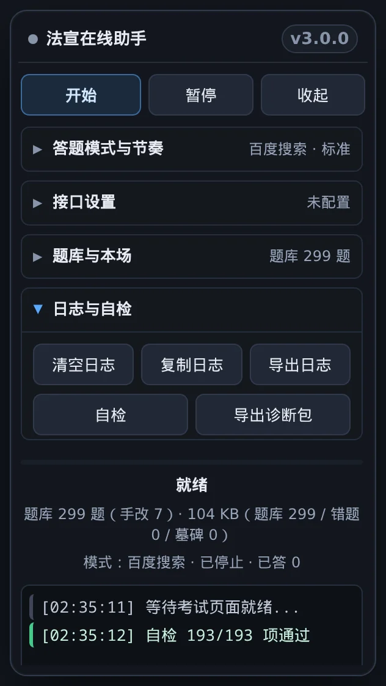

# 甘肃省国家工作人员学法考试平台自动答题助手

  
  

用于 **法宣在线**（`*.faxuanyun.com`）学法考试平台的 Tampermonkey 用户脚本。
单文件、无构建、无第三方依赖：结构化题库 + 站点适配层 + AI / 百度双通道查答案 + 内置自检。

> [!WARNING]
> **本项目仅供个人学习与研究使用。** 自动答题可能违反考试平台的使用规则，
> 由此产生的一切后果由使用者自行承担。
> 脚本联网查询会访问第三方站点（百度、以及你自己配置的 AI 接口），
> 请自行遵守其服务条款与访问频率约定。
> 本项目是个人自用工具，与**法宣在线**平台及其运营方没有任何关联，不是官方产品；
> 平台改版或风控策略变化时脚本可能随时失效，是否使用、如何使用由你自行判断。

---

## 目录

- [特性](#特性)
- [安装](#安装)
- [升级到 v2.0.0](#升级到-v200)
- [更新与自动更新](#更新与自动更新)
- [使用](#使用)
- [答案优先级](#答案优先级)
- [导入 / 导出](#导入--导出)
- [数据与隐私](#数据与隐私)
- [常见问题](#常见问题)
- [已知限制](#已知限制)
- [贡献](#贡献)
- [许可](#许可)
- [更新记录](#更新记录)

## 特性

- **结构化题库**：以「归一化题干的指纹」为主键，题号变动、同题不同表述都能复用；
  答案优先存**选项内容**（选项乱序也能对上），同时兼容纯字母答案与判断题的 `1/0`
- **用户答案优先**：你在页面上手动改的答案会被正确归属到对应题目、**立即入库**并标记来源「用户」；
  导入答案库时，用户答案不会被脚本答案覆盖
- **自我纠错**：答错会删掉库里记错的答案并记下错误选项 / 已失败的多选组合；
  判定答对会清掉本题错题记录并修正答案
- **多源查询**：题库 → AI（OpenAI 兼容接口）→ 百度搜索；主源把握不足或是多选题时自动追加次源交叉验证，
  两源冲突且优势不足时宁可不答。面板「二源」可强制每题交叉验证；题库里冲突过的题会自动改走联网复核
- **失败分类与退避**：题干未渲染 / 选项未渲染 / 算不出答案 / 点击没生效 / 选中项没文本各有容忍次数，
  连续失败递增退避，不会一有风吹草动就整场停掉
- **考试流程控制**：自适应切题等待、最后一题识别、暂停 / 继续 / 续答、回退保护、倒计时提醒与末段提速、
  弹窗安全处理（涉及交卷 / 提交的弹窗一个按钮都不会被自动点，包括「取消」）
- **交卷后自动收尾**：成绩解析与入库流程走完后按设置自动关闭考试页（默认 8 秒，可在面板
  「题库与本场 → 关闭页」切 8 / 15 / 30 秒或关闭，倒计时中再点一下可取消）；浏览器不允许脚本关闭
  自己没打开的标签页时，日志会提示手动关闭，脚本不重复尝试
- **面板**：可拖拽、一键收起（收成一条写着自己名字的窄条）、**按钮按用途分类折叠**、分类标题带实时状态摘要、
  快捷键、Shadow DOM 隔离站点样式（面板样式不污染页面，页面样式也不会打乱面板）、日志分级与导出、题库导入导出
- **内置自检**：190 项纯函数断言，面板一键运行；不联网、不读写题库数据
- **多标签页保护**：多开标签页时先后落盘不会互相覆盖，删掉的条目不会被旧副本搬回来；同一场考试请只留一个标签页
- **手动对账兜底**：答题卡识别不出时按题号手填对错，照常走对账 / 入库 / 错题清理（用法见 [常见问题](#常见问题)）

## 安装

1. 浏览器安装 [Tampermonkey](https://www.tampermonkey.net/)（或 Violentmonkey）
2. 安装脚本，按下面顺序挑一个能用的：
   - **推荐**：到 [Releases](https://github.com/Gnayiel/faxuanyun-legal-exam-assistant/releases/latest) 下载最新版本的
     `.user.js` 附件，拖进浏览器窗口安装。
     这条永远拿到**最新版**；装好后自动更新走 `@updateURL`（`@2`），后续版本由油猴按自己的检查间隔自动装上。
   - 浏览器里能打开 GitHub 时，也可直接点仓库里的
     [`faxuanyun-legal-exam-assistant.user.js`](faxuanyun-legal-exam-assistant.user.js) 再点 **Raw**。
   - 国内多数网络下 github.com / raw.githubusercontent.com 不通，改用 jsDelivr 固定版本直链（把 `vX.Y.Z`
     换成 [Releases](https://github.com/Gnayiel/faxuanyun-legal-exam-assistant/releases/latest) 里的最新标签，
     例如 `v2.0.17`）——地址与内容一一对应，装到的一定是那个版本：
     `https://fastly.jsdelivr.net/gh/Gnayiel/faxuanyun-legal-exam-assistant@v2.0.18/faxuanyun-legal-exam-assistant.user.js`
   - 想省事、不介意 CDN 缓存可能稍滞后时，可用 jsDelivr 的 `@2` 主版本别名直链（当前解析到最新 2.x）：
     `https://fastly.jsdelivr.net/gh/Gnayiel/faxuanyun-legal-exam-assistant@2/faxuanyun-legal-exam-assistant.user.js`
   - 上述都不通时，用 `gcore.jsdelivr.net` / `testingcf.jsdelivr.net` 替换主机名；`cdn.jsdelivr.net` 在国内多被重置。
   - ⚠️ 镜像路径**区分大小写**，请照抄 `Gnayiel`。
3. 打开考试页面，右上角会出现控制面板

> **更新安装不会丢题库**：脚本身份由 `@name` + `@namespace` 决定，**改文件名、改仓库地址都不影响**。
> 反过来，改动 `@name` 或 `@namespace` 会被油猴当成一个新脚本，用户已存的题库会「找不到」——
> v2.0.0 就是这么一次破坏性变更，升级方式见下一节。

脚本文件名里的 `.user.js` 后缀**不要改**，这是油猴识别安装的必要条件。

装好之后不用再手动跟进：脚本头部带 `@updateURL` / `@downloadURL`，后续版本的自动更新由油猴完成，
细节见 [更新与自动更新](#更新与自动更新)。

## 升级到 v2.0.0

v2.0.0 重命名了脚本文件与导出文件前缀，属于**破坏性变更**：

| | v1.x | v2.0.0 |
|---|---|---|
| 脚本文件 | `faxuanyun-auto-exam.user.js` | `faxuanyun-legal-exam-assistant.user.js` |
| 脚本身份 `@namespace` | `http://tampermonkey.net/`（油猴默认值） | `https://github.com/GNAYIEL/faxuanyun-legal-exam-assistant` |
| 仓库 slug | `faxuanyun-auto-exam` | `faxuanyun-legal-exam-assistant` |
| 题库导出前缀 | `faxuanyun-answer-bank-*` | `faxuanyun-legal-exam-bank-*` |
| 日志导出前缀 | `faxuanyun-exam-log-*` | `faxuanyun-legal-exam-log-*` |
| 备份 JSON 的 `format` 自述 | `faxuanyun-answer-bank` | `faxuanyun-legal-exam-bank` |

`@namespace` 变了（v1.x 用的是油猴默认值 `http://tampermonkey.net/`），所以油猴把 v2.0.0 当成**全新脚本**：
不会自动继承 v1.x 的数据。升级步骤：

1. 在**旧版**面板「题库与本场」里点「导出答案库」（或「日志与自检 → 导出日志」备份日志）
2. 安装 v2.0.0
3. 在新版面板「题库与本场」里点「导入答案库」，选刚才导出的 `.json`（换电脑、跨版本都用它，字段一个不少）
4. 确认题库题数、来源标记都正常后，卸载旧版

**旧导出文件照样能导入**：导入只认「有没有 `bank` 容器 / 是不是一张题干字典」，
**不校验 `format` 的取值**，所以 v1.x 导出的文件名和 `format` 旧值都不影响导入。
真正标识数据结构版本的是 `schema` 字段（当前为 `2`）。

## 更新与自动更新

> [!IMPORTANT]
> **还在用 ≤ v2.0.12 的旧版？必须手动重装一次，自动更新才会恢复。** 那些版本的 `@updateURL`
> 指向 `cdn.jsdelivr.net`，该域名在国内多数网络下连接被重置（实测已不可达），油猴每次检查更新都会
> 静默失败。按 [安装](#安装) 用 Release 资产或 `@2` 链接覆盖安装一次即可：脚本身份不变，
> 题库与设置都保留；装到 v2.0.13 及以上后，新的 `@updateURL` 才会接管后续更新。

脚本头部已经写好 `@updateURL` / `@downloadURL`，都指向本仓库 **2.x 最新 tag** 上这个脚本的
**jsDelivr 镜像**（`fastly.jsdelivr.net/gh/Gnayiel/...@2/...`）——`@2` 是 jsDelivr 的语义化
主版本别名：只要最新 tag 还是 2.x，油猴检查更新就会解析到最新 2.x；将来升 3.0 时再改一次 `@3`。
换成镜像是因为 `raw.githubusercontent.com` 在国内多数网络下不可达，会让「检查更新」静默失败。
**v2.0.13 起，装好一版之后不需要再做任何事**，后续版本由油猴自动更新。

> 为什么用 `@2` 而不是 `@latest`：jsDelivr 的 `@latest` 别名缓存最长 7 天
> （实测 `cache-control: public, max-age=604800, s-maxage=43200`）。2026-10-21 发布 v2.0.16 约 9 小时后，
> 三个边缘的 `@latest` 仍全部返回 2.0.14；切到此前未被缓存的 `@2` 后，三个边缘立即解析到 2.0.16。
> `@2` 同样受边缘缓存影响，发版后仍可能短暂滞后，但不会继承 `@latest` 已缓存的旧版本；
> 想立刻拿到指定版本，用 `@vX.Y.Z` 固定链接——新 tag 的固定链接在三个边缘都是立即生效的。

### 用户侧：油猴怎么更新

- **自动检查**：油猴在后台按自己的检查间隔（可在油猴设置里调整）请求 `@updateURL`，
  读取远端的 `@version` 并与本地比较；远端更高时按 `@downloadURL` 下载新脚本并替换旧脚本。
  已经打开的页面不会热替换，刷新页面或下次打开就会跑新版本。
- **手动检查**：油猴管理面板 →「已安装脚本」页点「检查更新」；
  Violentmonkey 在脚本列表 / 脚本详情页点「更新」。装好后列表里的版本号会变成新版。
- **数据不丢**：更新是「同一个脚本」的原地替换，身份由 `@name` + `@namespace` 决定，
  题库、错题记录、AI 设置、面板位置都保留。只有改 `@name` / `@namespace` 才会被当成新脚本
  （v2.0.0 就是这么一次，迁移见上一节）。
- **更新失败的兜底**：自动更新走 jsDelivr，若它也不通（CDN 故障 / 网络限制 / 边缘还没刷新），
  检查会静默失败（不会损坏数据）。可以换网络后重试，或等几小时再查；也可以到
  [Releases](https://github.com/Gnayiel/faxuanyun-legal-exam-assistant/releases/latest) 下载该版本的
  `.user.js` 附件，或直接用上面 `@vX.Y.Z` 固定链接安装——
  同一脚本的新版本会覆盖旧版本，效果与自动更新一致，数据同样不丢。
  GitHub 被拦截时也可以直接让维护者把该版本发给你（与本仓库文件一致、可对 SHA256），拖进浏览器安装即可。
  排查更新问题时，可附上面板「日志与自检 → 导出诊断包」生成的 JSON。

## 使用

### 面板

顶栏是**常驻**的，不随分类收起；其余按钮按用途分成 4 类，**点分类标题才展开**同类按钮
（默认收起，展开状态会记住）。

| 区域 | 说明 |
|---|---|
| 开始 / 停止 | 常驻顶栏。停止后再点「开始」会从当前题接着答，已答过的题不重答 |
| 暂停 / 继续 | 常驻顶栏。暂停期间不会再去点页面；继续后从原位置接着走 |
| 收起 / 展开 | 常驻顶栏。一个按钮：收成一条写着自己名字的窄条（还能拖动），再点一下还原 |
| **答题模式与节奏** | AI智能 / 百度搜索（选主查询通道，另一条作为备源）；二源（默认关，打开后每题都追加第二个来源交叉验证）；节奏（慢速 3~6 秒 / 标准 1~3 秒 / 快速 0.3~0.8 秒）；交卷（手动默认，答完只提示 ／ 自动，需谨慎）；调试（输出更详细的日志）。摘要显示当前模式与节奏 |
| **接口设置** | AI 设置（接口地址 / API Key / 模型名，保存前逐项校验）；「Key 仅本次会话」勾选后 Key 不落盘（刷新后需重填）；测试连接。摘要显示接口是否已配置 |
| **题库与本场** | 导出 / 导入答案库（见 [导入 / 导出](#导入--导出)）；导出争议题（题库里被标记过错误/争议的条目与两源冲突记录，导出 JSON 供人工复核）；解析成绩（交卷后手动再解析一次）；手动对账（答题卡识别不出时按题号手填对错，详见 [常见问题](#常见问题)）；关闭页（成绩解析/入库完成后自动关闭本页的秒数，默认 8 秒，可切 8/15/30/不关，倒计时中再点一下取消）；清空本场（丢弃本场记录）。摘要显示题库题数与已答数 |
| **日志与自检** | 清空 / 复制 / 导出日志（最多留 300 行）；自检（跑内置断言）；导出诊断包（版本、UA、页面地址（不含查询串）、选择器命中、配置、请求统计、存储占用与最近 300 行日志；已脱敏，不含 API Key）。摘要显示日志行数 |

收起时分类标题右侧的摘要是活的：切模式、改节奏、答了几题、写了几行日志都会即时刷新，
不展开也能看到关键状态；展开后摘要让位给按钮（按钮自己带状态）。
分类标题支持鼠标点击，也支持键盘 `Enter` / 空格。

面板整体可拖拽，位置会记住；拖动后如果超出视口，缩放窗口时会自动拉回可见范围。

### 快捷键

| 快捷键 | 作用 |
|---|---|
| `Alt + S` | 开始 / 停止 |
| `Alt + P` | 暂停 / 继续 |
| `Alt + H` | 收起 / 展开面板（等同顶栏那个按钮） |
| `Alt + L` | 清空日志 |
| `Alt + E` | 导出日志 |
| `Alt + D` | 开关调试 |
| `Alt + T` | 运行自检 |

在输入框里打字时快捷键不会触发。收起面板分类不影响快捷键（按钮仍在 DOM 里）。
判键用的是物理键位（`KeyboardEvent.code`），所以在非拉丁输入法或 macOS 上也不会静默失效。

### AI 接口配置

- 在面板「接口设置」里点「AI 设置」，填 OpenAI 兼容的接口地址
  （形如 `https://api.deepseek.com/v1/chat/completions`）、API Key、模型名
- 内置 `@connect` 白名单：`www.baidu.com`、`api.deepseek.com`、`api.openai.com`、
  `dashscope.aliyuncs.com`、`open.bigmodel.cn`、`api.moonshot.cn`、`api.siliconflow.cn`、
  `ark.cn-beijing.volces.com`
- 用其它服务时，需要在脚本头部补一行 `// @connect 你的域名`；保存设置时脚本会检测并提示你要补哪一行。

## 答案优先级

| 来源 | 优先级 | 说明 |
|---|---|---|
| 用户手动答案（`by='user'`） | 最高 | 你在页面上改的答案立即入库并标记「用户」 |
| 交卷判定答对 | 高 | 已被验证的正确值，写库时覆盖旧值（**不论旧值来自谁**） |
| 导入的脚本答案 | 低 | 不会覆盖库内已有的用户答案，只记为冲突 |

导出 CSV 的「来源」列会写明每条是「用户」还是「脚本」，导入时据此还原优先级。

## 导入 / 导出

**导出**一次给两个文件，文件名统一为 `faxuanyun-legal-exam-bank-<日期>`
（如导出于 2026-10-20 就是 `faxuanyun-legal-exam-bank-20261020.*`，两个文件共用同一个日期戳，按天归档）：

- `faxuanyun-legal-exam-bank-20261020.csv` —— 六列 `序号,题型,题目,正确答案,错误选项,来源`，
  带 UTF-8 BOM + CRLF，Excel 双击不乱码
- `faxuanyun-legal-exam-bank-20261020.json` —— 字段完整的备份，可无损往返；**换电脑、跨版本升级建议用它**

> 日期取**本机本地时间**；同一天导出第二次时，浏览器会自动加 `(1)` 之类的后缀，两次的快照都留着。
> 导出日志同理，文件名是 `faxuanyun-legal-exam-log-<日期>-<时间>.txt`。
> 命名规范的完整说明见 [`data/README.md`](data/README.md)。

**导入**支持 `.csv / .json / .txt / .tsv`：

- 自动嗅探分隔符（逗号 / Tab / 分号 / 竖线）与编码（UTF-8 / UTF-16 / GB18030 / GBK / Big5）
- 有表头按列名映射（序号 / 题型 / 题目 / 正确答案 / 错误选项 / 来源），没有表头按列数推断
- JSON 支持本脚本的完整备份（含 v1.x 导出的旧前缀文件）、`{bank, wrong}` 结构、数组形态、
  以及「一张 `{题干: 答案}` 字典」
- 注意：选项内容里自带 `;` 或 `+` 时，CSV 往返会被拆项（导出时会提示），此时以 JSON 为准

仓库 [`data/`](data/) 里随附了一份 299 题（单选 90 / 多选 59 / 判断 150，无错误记录）的题库快照，可以直接导入。

想合并多台电脑 / 多份导出的题库，用 `node tools/merge-bank.mjs a.json b.csv -o merged.json`：
同一题自动去重、用户手改答案优先、脚本答案冲突保留较新的并累加冲突次数、错题记录取并集，输出可直接导入。

## 数据与隐私

脚本使用油猴存储保存：题库、错题记录、未交卷会话、面板位置、面板收起状态与分类展开状态、AI 设置。

API Key 落盘前会做一次**异或 + Base64 混淆**——请知悉这**不是加密**：脚本是开源的，任何人都能还原。
它的目的只是不裸存，避免顺手被看到，或随存储一起导出时泄露。全程不打印 Key，导出的答案库也不包含 Key。

首次使用会弹一次使用须知，点击确认后不再提示。

脚本向哪台服务器发请求是可枚举的：脚本**主动发起**的请求只会发往上面 `@connect` 白名单里的域名（百度 + 你配置的 AI 接口），
不会回传任何遥测数据。页面上的题干会作为查询词发送给这些第三方服务。
百度结果里的「跳转链接」由百度服务端 302 到你搜索到的网页，落地域名不受本脚本控制。

脚本没有「只用题库、不联网」的独立模式，题库未命中时才会发起查询；介意的话请不要在考试中使用联网查询，或直接停止脚本。

## 常见问题

- **搜不到答案？** 这个平台的题目在公网**不容易搜到、但不是完全搜不到**；百度通道只能拿到服务端返回的
  HTML，**无法执行页面 JS**，所以纯 JS 渲染的结果页、需要验证码的页面都取不到。命中率不高是正常现象。
- **脚本停下来了？** 连续同类失败会停手并说明原因（日志里会写「同类失败 N/M 次」）。
  展开面板「答题模式与节奏」把「调试」打开，能看到更细的过程。
- **想换台电脑？** 用导出的 `.json` 导入，字段一个不少。
- **重进同一场考试？** 脚本会恢复 3 小时内未交卷的记录并提示你；
  如果这是新一场考试，请点面板「清空本场」；已交卷的残留记录会在下次开考时自动清空，不再提示。
- **交卷后解析不出对错？** 先确认已经停在成绩页；有的版本答题卡默认收起，点开「查看答题卡 / 查看解析」后
  脚本会自动再解析一次。仍失败就展开「答题模式与节奏」打开「调试」，再点「解析成绩」，
  用 `Alt + E` 导出日志反馈——日志里会写明扫描了多少元素、图例拿到了什么颜色、页面上有哪些入口。
  实在识别不出来时，用面板「题库与本场 → 手动对账」按 `1-8=对, 9=错, 10=未答` 手填，脚本会走同一套入库流程。
  另外 v2.0.2 起，交卷后退回「选择考试」列表页不会再被误判成成绩页空转解析（旧版会红字提示「确认停在结果页」）。
- **从 v1.x 升级后题库是空的？** 这是预期行为（`@namespace` 变了），按
  [升级到 v2.0.0](#升级到-v200) 用 `.json` 导入一次即可。
- **自动更新一直不生效？** 按顺序排查：① 看面板标题栏的 `@version` 是否低于期望版本；
  ② 还在 v2.0.12 及更早版本时，旧的 `@updateURL` 指向已不可达的 `cdn.jsdelivr.net`，必须按
  [安装](#安装) 手动覆盖安装一次（题库与设置保留）；③ v2.0.13 起走 `@2`，受边缘缓存影响，
  发版后通常要数小时才陆续刷新，不保证即时，想立刻用新版就改用 `@vX.Y.Z` 固定链接手动装；
  ④ 在油猴管理面板点「检查更新」强制查一次，更新后刷新考试页；⑤ 仍不行就下载 Release 里的
  `.user.js` 覆盖安装，或把「导出诊断包」的 JSON 附到 issue 里。
- **API Key 怎么申请、填哪家？** 脚本不提供 Key、也不代理请求：AI 模式需要你自己在任一家
  OpenAI 兼容服务商注册并创建 API Key（例如 DeepSeek 开放平台，接口地址
  `https://api.deepseek.com/v1/chat/completions`、模型名 `deepseek-chat`）。在面板
  「接口设置 → AI 设置」填好接口地址 / Key / 模型名并保存，再点「测试连接」。
  脚本头部 `@connect` 已内置 [AI 接口配置](#ai-接口配置) 列出的那些域名，用其它服务商时
  需要自行补一行 `// @connect 你的域名`。不想配 Key 就把模式切到「百度搜索」，不需要任何 Key。
- **导入答案库失败 / 只导入了一部分？** 先看面板日志：导入结束会写明新增 / 补齐 / 归并 /
  答案冲突 / 无法导入各多少条，并列出前 5 条失败原因（含行号与原文）。常见原因：JSON 不是脚本
  认识的结构（完整备份、`{bank, wrong}`、数组、`{题干: 答案}` 字典之一）、CSV 表头或列数对不上、
  答案超出选项范围、选项内容里带 `;` 或 `+` 被当成多选拆项（此时改用 JSON）。自己看不出时，
  点「导出诊断包」把 JSON 和原文件一起发 issue；诊断包已脱敏，不含 API Key。

## 已知限制

- **题库答案不保证正确**。它是答题过程中累积下来的，靠交卷判定自我纠错；
  跨电脑搬运请用 `.json`，不要用 Excel 手改 CSV（选项内容里的 `;` / `+` 会被拆项）。
- **判断题只做「安全相似复用」**：判断题选项永远是「正确 / 错误」，字面相近但语义相反的题干
  （「…一切权力属于人民」vs「…一切权力不属于人民」）相似度也高。所以判断题只在题干规范化后
  完全相等，或长度 ≥ 10 且编辑距离 ≤ 2、否定词与模态词（必须/应当/可以/不得等）一致、题库中唯一命中时才复用，其余一律走网络。
- **百度通道仍有不确定性**：查询词会出现在搜索结果里，脚本已用 `stripQueryEcho` 剔除回显并给百度结果降权
  （×0.9）；超长题干按头 40 + 尾 20 字符检索，跟进页先过题干相关性，单题所有网络请求共享 20 秒预算。
  跟进页响应体超过 512 KB 会被截断；但反爬页、纯 JS 渲染的结果页仍然取不到，最终把握度只能参考。
- **对账是保守的**：交卷后如果题号不可靠、两边条数又对不上，脚本**只出报告、不写题库**，
  宁可少学一条也不写错一条。
- **推断不出总题数时不会自动交卷**：为了不出现「答了 10 题就被当成答满」的提前交卷，
  题目里读不到总题数时脚本会把最后一题留给手动交卷。
- **答题卡颜色判定宁可不写**：正确 / 错误 / 未答三色接近时优先判「未答」，这一题就不入库，
  等你人工核对。
- **争议题只记录、不自动改**：两个来源都高置信但分歧时记入争议列表（面板可导出人工复核），
  不会自动挑一个写进题库。
- **多标签页**：写保护只保证先后落盘不互相覆盖（3 秒短锁 + 读盘合并 + 墓碑，墓碑持久 7 天、
  每 10 次落盘或超过 500 条时清理过期项）；同一场考试同时在两个标签页作答仍会产生分叉记录，
  脚本检测到会提醒，建议只留一个标签页。
- **自动关闭本页受浏览器限制**：脚本只能关闭「自己打开的」标签页；考试页是你自己点开时，
  `window.close()` 可能被浏览器拒绝。被拒绝时脚本不会反复重试，也不会擅自跳走页面，
  只在日志与通知里提示手动关闭。

## 贡献

- 报 bug / 提需求请用 [issue 模板](.github/ISSUE_TEMPLATE/bug_report.yml)，附浏览器与油猴版本、脚本 `@version` 与面板日志（`Alt + E` 导出）
- 安全问题（含泄露的 API Key）请按 [SECURITY.md](SECURITY.md) 私下报告，**不要**公开贴；参与讨论请遵守 [CODE_OF_CONDUCT.md](CODE_OF_CONDUCT.md)
- 想改代码、跑测试或发版，见 [CONTRIBUTING.md](CONTRIBUTING.md)

## 许可

[MIT](LICENSE)

## 更新记录

当前版本 **v2.0.18**（2026-10-21）：修复 `A,B` / `A、B` 字母答案在导入与解析链路上的回归；收起态保留「开始/停止」入口；沿用 `@2` 更新别名与运行代际/中止机制。

每一项改动的说明与验证方式见 [CHANGELOG.md](CHANGELOG.md)，更早版本在 [CHANGELOG-archive.md](CHANGELOG-archive.md)。
