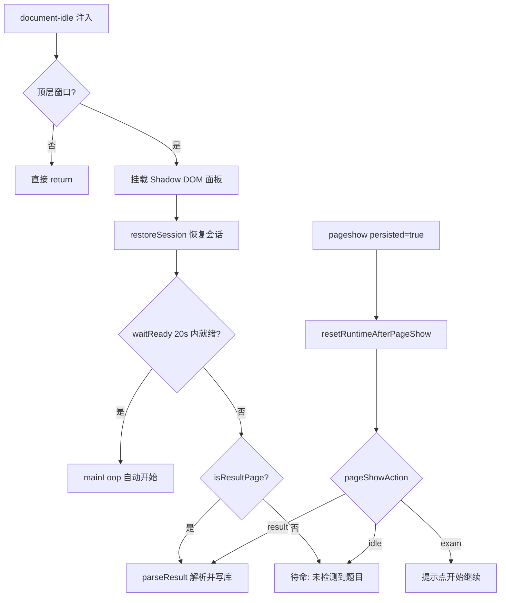
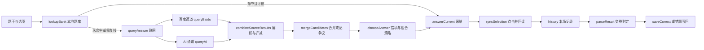

# 架构说明：法宣在线自动答题助手

本文面向需要修改脚本的维护者，讲清楚运行时怎么分层、题库数据怎么存、一道题从题干到答案再到成绩对账经历了什么，以及测试体系如何兜底。README 讲「怎么用」，[开发与测试](DEVELOPMENT.md)讲「怎么跑测试、怎么发版」，本文只讲「为什么这样组织」。

脚本是一个约 7.8k 行的单文件 `faxuanyun-legal-exam-assistant.user.js`，内部用 `// ==================== 名称 ====================` 分隔逻辑段。本文用段名与函数名指代位置，不写行号——脚本还会继续变长，行号会漂移。

## 1. 设计目标与硬约束

| 约束 | 落地方式 |
| --- | --- |
| 单文件、无构建、无第三方依赖 | 运行时没有 `import`/`require`；`package.json` 不声明依赖；工具链只用 Node 内置模块 |
| 体积有上限 | 脚本约 441 KB；`tests/selftest.mjs` 设 512 KB 预算，并同步校验 README 徽章与自检数量 |
| 版本单一来源 | UserScript 的 `@version` 是唯一版本号；运行时 `VERSION` 取 `GM_info.script.version` |
| 不越权注入 | `@run-at document-idle`、`@noframes`，并用 `window.top !== window.self` 提前返回兜底 |
| 不引入遥测 | 只访问 `@connect` 白名单里的 8 个域名；诊断包由用户手动导出 |
| 平台改版可隔离 | 选择器与按钮文案集中在站点适配层的 `SEL`、`BTN`，其余逻辑不感知页面结构 |
| 默认不替用户交卷 | `autoSubmit` 默认 `false`，`finishExam` 只提示；开启后也只点弹窗内的确认按钮 |
| 数据留在本地 | 题库、错题、设置、日志都在油猴存储里，离线时降级为本地题库 + 排除法 |

维护者最需要记住的两条边界：**页面结构变化只改适配层**；**答案写回以「交卷后判定答对」为最高证据**，用户手改只影响「未经交卷验证」的场合。

## 2. 代码分段与运行时分层

| 段 | 职责 | 关键入口 |
| --- | --- | --- |
| UserScript 元数据与 `CONFIG` | 版本、权限、全部可调参数 | `CONFIG`、`SPEED`、`SPEED_NAME`、`VERSION` |
| 站点适配层 | 选择器候选、按钮文案、题型与总题数正则 | `SEL`、`BTN`、`TOTAL_RE`、`JUDGE_*` |
| 通用工具 | 取元素、日志、混淆存储、节流、下载 | `pick`、`log`、`safe`、`getKey`/`setKey`、`downloadFile` |
| DOM 解析 | 题干、选项、题型、题号、总题数、按钮缓存 | `getStem`、`getOptions`、`getType`、`getQNum`、`getTotalQExact`、`pickButton` |
| 题库（数据层） | schema 2 条目、主键、索引、容量 | `normStem`、`fpKey`、`blankEntry`、`lookupBank`、`enforceCapacity` |
| 持久化墓碑 | 跨标签页删除不被复活 | `addTombstone`、`isTombstoned`、`syncFromStorage` |
| 多标签页写锁 | 落盘互斥、读盘合并 | `acquireWriteLock`、`flushBank`、`mergeFromStore` |
| 同场双页检测 / 人工对账 | 活跃页心跳、手动判定解析 | `claimActiveTab`、`parseManualVerdicts` |
| 导入导出 | CSV/JSON 解析、表头映射、公式消毒 | `importCsv`、`importJson`、`exportCsv`、`exportJson` |
| 答案抽取 | 规则抽取、AI JSON、多源合并、争议记录 | `extractAnswer`、`extractAIAnswer`、`mergeCandidates` |
| 网络请求 | `GM_xmlhttpRequest` 封装、并发、重试、预算 | `request`、`queryBaidu`、`queryAI` |
| 会话级答案缓存 | 同场同题不重复联网 | `answerCacheKey`、`cacheLookup`、`cacheStore` |
| 答题核心 | 单题决策、点击回读、切题等待 | `answerCurrent`、`syncSelection`、`waitForNew` |
| 作答策略 | 候选、错项排除、多选组合 | `chooseAnswer`、`multiComboPlan` |
| 成绩解析 | 答题卡判定、分数、对账规划 | `collectResult`、`readScore`、`planResultActions`、`reportResult` |
| 考试流程控制 | 主循环、暂停、弹窗、交卷、退出原因 | `mainLoop`、`pauseAwareSleep`、`handleDialogs`、`finishExam` |
| 内置自检 | 纯函数断言与浏览器测试钩子 | `selfTestCases`、`runSelfTest`、`window.__FX_TEST__` |
| 存储占用 / 导出 | 体积统计、诊断包、争议包 | `storageFootprint`、`buildDiagnostics`、`buildDisputesExport` |
| 面板 | Shadow DOM UI、分组、快捷键 | `createPanel`、`PANEL_GROUPS`、`toggleGroup` |
| 往返缓存恢复 | 从 bfcache 返回时复位运行态 | `resetRuntimeAfterPageShow`、`pageShowAction` |

分层原则是「高层只依赖低层的纯函数」：流程控制不直接碰选择器细节，对账不直接算 DOM 颜色，策略不直接写存储。这样自检才能在 Node 里只加载脚本、不打开浏览器就断言大部分判断逻辑。

## 3. 启动与页面生命周期

| 页面类型 | 判定方式 | 脚本行为 |
| --- | --- | --- |
| 考试页 | 能取到题干且 `getOptions()` 非空 | 20 秒内就绪即自动开始；已答题记录会跳过 |
| 成绩页 | `isResultPage()`：出现结果页专有措辞，或「分数 + 答题卡/对错字样」，或答题卡至少 3 格且至少 1 个正确/错误判定；光有分数不算 | 自动解析；从 bfcache 返回时重解析但对账幂等 |
| 选择考试 / 列表 / 登录页 | 上面两者都不成立 | 面板照常可用，状态显示「未检测到题目」 |
| 交卷确认弹窗 | `isSubmitConfirm` 识别「确定交卷 / 确认交卷」类文案 | 默认只点安全按钮；交卷确认需 `autoSubmit` 且只点弹窗内按钮 |

启动顺序值得注意：

1. 面板先挂载并恢复位置、折叠状态、分组状态，再进入就绪探测；探测期间日志与自检已可用。
2. `restoreSession()` 恢复 3 小时内的本场记录；已交卷且当前不是成绩页时直接清掉残留，上次记录的路径与本次不同且不是成绩页时不恢复；路径相同但查询串变了仍恢复，只标记「可能不是同一场」并禁止自动交卷。
3. 就绪后调用 `mainLoop()` **自动开始**，不要求用户再点「开始」；失败时停在待命分支，面板显示「未检测到题目」。
4. 停止按钮依次 `cancelRun()`、`abortPendingWaits()`、`releaseActiveTab()`：旧循环和旧请求立即失效，切题等待不再卡满超时，另一页也不再误报同场双开。
5. 重新开始会 `beginRun()` 递增运行代际，旧循环即使从 `await` 里醒来也会发现自己过期并退出。
6. bfcache 恢复只处理 `pageshow.persisted === true`：复位运行态、解析锁、自动关闭计时器、双页心跳与交卷识别时间戳，120ms 后重新探测页面类型。

## 4. 站点适配层

`SEL` 的每个字段都是「按优先级排列的选择器数组」，命中第一个可见元素即用；`BTN` 用文案标签加排除词定位按钮。

| 字段 | 用途 | 候选示例 |
| --- | --- | --- |
| `box` | 题目容器 | `#timucontent`、`#questionContent`、`.exam-content` |
| `stem` | 题干 | `h2`、`h3`、`.question-title`、`.q-title`、`.stem`、`h1` |
| `optionInput` | 选项控件 | `input[name="option"]`、`input[name^="answer"]`、`.option input` |
| `optionInputLoose` | 宽松兜底 | `input[type="radio"]`、`input[type="checkbox"]` |
| `optionHolder` | 选项行容器 | `label, li, .option, .opt, dd, p` |
| `clickable` | 可点元素 | `a`、`button`、提交类 `input`、`[role="button"]` |
| `dialog` | 弹窗 | `.layui-layer`、`.el-dialog`、`.modal`、`[role="dialog"]` |
| `timer` | 倒计时 | `#timer`、`#remainTime`、`.remain-time`、含 timer 的 id/class |

| 按钮 | 文案 | 排除 |
| --- | --- | --- |
| 下一题 | 下一题、下一页 | 上一题、上页 |
| 交卷 | 交卷 | 确定、确认 |
| 交卷确认 | 确定交卷、确认交卷、确定、确认 | 由 `dialogNeverAuto` 再排除「返回 / 离开 / 退出」 |

适配层的几条约定：

- 选项控件先查 `optionInput`，不足 2 个再退到 `optionInputLoose`，避免把页面上的搜索框当成选项。
- 只有题干和选项都出现才算就绪，缺一个就继续等；题号读不到时用 0 表示未知，不猜。
- 按钮缓存（`buildButtonCache`）只由可点元素的 DOM 变化触发重建；倒计时文字变化不再导致整棵按钮缓存重建。
- 总题数先按题型统计「共 N 题」，只有一条或数值不合理时再扫页面数字，仍推断不出就返回 0，流程不会用 10 当兜底。
- 平台改版时优先只改 `SEL`/`BTN`；选择器命中情况会出现在诊断包的 `sel` 字段里，配合 `tests/fixtures` 与页面冒烟测试验证。

## 5. 题库数据模型

### 5.1 主键与归一化

- `pureStem` 去掉题号前缀与「(单选/多选/判断)」标记，用于展示与旧键兼容。
- `normStem` 进一步去空白、统一小写、去中英标点，作为「同题不同表述」的归一化形式。
- `fpKey(stem)` 是主键：对 `normStem` 做 FNV-1a 32 位哈希，输出 8 位十六进制加长度 base36，再加 `#` 前缀。不依赖外部库，碰撞概率足够低。
- 相似题索引 `bankIndex()` 取 `normStem` 前 12 字建桶；`lookupBank` 的顺序是「指纹精确 → 旧版 50 字截断键 → 前缀桶 + 相似度」，相似度必须达到 0.9 且第二名也低于阈值才采用，否则视为有歧义。
- 判断题不走普通相似度：`judgeStemMatch` 只接受「归一化后完全相等」或「双方长度至少 10 且编辑距离不超过 2」，并且否定词数量、模态词、量化词必须完全一致，题库里还必须唯一命中；任一条件不满足就交回联网查询。
- `upgradeKey` 只有在「归一化后较短的一方是另一方前缀，且较短者至少 30 字」时才允许改键，防止相似题互相搬运条目。

### 5.2 条目字段

| 字段 | 含义 |
| --- | --- |
| `q` | 干净题干（`pureStem`） |
| `t` | 题型：`single` / `multi` / `judge` |
| `s` | 科目，默认「甘肃省国家工作人员学法考试」 |
| `a` | 答案的选项内容数组（主数据，选项乱序也能重新对上） |
| `l` | 答案字母（辅助；AI 只给字母时用） |
| `src` | 来源：`exam` / `import` / `legacy` / `user` |
| `by` | 手动标记，`user` 表示用户手改过 |
| `ts` / `us` | 首次入库时间 / 最近使用时间 |
| `hit` / `ok` / `bad` | 命中次数 / 已验证答对次数 / 答错次数 |
| `cft` | 答案冲突次数 |

条目由 `blankEntry` 统一构造；`isUserEntry` 等价于 `by === 'user'`。旧数据由 `migrateBank` 迁移：字符串条目转成结构体，答案里其实存着字母或 `1/0` 的会归位到 `l`。

### 5.3 答案优先级

源码头部的约定是理解写库行为的钥匙：

- 用户在页面上手改的答案会立刻以 `by='user'` 入库，但不增加 `ok`，因为平台在交卷前不告诉对错。
- 交卷后判定答对的答案**一律写回**，不管旧值来自脚本还是用户——它已经被验证为正确。
- 「用户答案优先」只用于「导入 vs 库内」这种双方都尚未被验证的场合，避免导入把用户手改覆盖掉。
- 导出 CSV 的「来源」列会标明「用户」还是「脚本」。

`saveCorrect` 返回 0/1/2：内容与来源都无需更新时 0、写入时 1、发生答案冲突时 2；即使没有写入也会累计 `ok`/`hit`。冲突时 `cft` 加一但新答案仍然生效，并清掉该题错题记录。`saveUserAnswer` 只覆盖内容并打用户标记，不做验证计数。

### 5.4 错题记录与争议

- `wrongBank` 的条目是 `{ q, w: [], tried: [] }`：`w` 是绝对不该选的选项文本，`tried` 是多选已失败组合（用 `comboKey` 归一）。
- 错题记录与题库共用主键，删除题库条目时两张表一起清，并各登记一条墓碑。
- 争议题存入 `fx_disputes`，最多 100 条，按「题干 + 候选签名」去重；面板可导出 `fx-disputes-YYYYMMDD.json`。

## 6. 持久化与多标签并发

### 6.1 存储键

| 键 | 内容 |
| --- | --- |
| `questionBank` | 题库条目字典，主键 → 条目 |
| `wrongBank` | 错题 / 失败组合 |
| `pendingSession` | 本场未完成的作答记录、地址、是否已交卷 |
| `fx_bank_tombs` / `fx_wrong_tombs` | 删除墓碑（保留 7 天） |
| `fx_disputes` | 多源冲突记录 |
| `aiUrl` / `aiModel` / `aiKey` | AI 配置；`aiKey` 落盘前用 `keySalt` 做异或 + base64 混淆 |
| `answerMode` / `speed` / `autoSubmit` / `autoCloseSec` / `forceCrossCheck` / `debug` | 面板设置 |
| `bankSchema` / `lastReconcileKey` / `complianceAck` / `panelPos` / `panelState` / `panelGroups` | 迁移标记、对账幂等键、首次提示、面板状态 |

### 6.2 写入路径

`ensureBank` / `ensureWrong` 惰性载入缓存，并跳过已墓碑化的键；写入只改内存并置 `dirty`，由 `flushBank` 统一落盘：

1. 先清掉自己的 `dirty` 标记，避免写盘过程中再次触发。
2. 刷新墓碑表，把其它标签页的条目并进内存（`mergeFromStore`），跳过本页刚删的键。
3. 执行容量淘汰（`enforceCapacity` / `enforceWrongCapacity`）。
4. `GM_setValue` 写题库与错题，写成功后才清空 pending 删除集合；失败恢复 `dirty` 并抛错。
5. 用 `GM_addValueChangeListener` 监听远端变化；远端写库时调用 `syncFromStorage`，把「盘上新增」并入、把「盘上消失」当作对方删除并登记墓碑。
6. 落盘优先用 `navigator.locks.request('fx-question-bank-write')` 串行化，1.2 秒拿不到锁再退回软锁（`acquireWriteLock` 写入后二次确认 owner）。

容量策略：题库上限 2000 条，按「用户手改 > 本次导入 > 普通」优先级、再按 `ok*3 + hit - bad*2`、最后按最近使用时间淘汰；错题上限 500 条，按信息量淘汰。淘汰同样登记墓碑，否则另一标签页的合并会把它们搬回来。

### 6.3 墓碑、写锁与双页心跳

| 机制 | 作用 | 关键参数 |
| --- | --- | --- |
| 墓碑 | 记录本页删除过的键，合并时跳过，防止旧副本复活 | 保留 7 天，每 10 次落盘清理一次 |
| 写锁 | 多标签页同时落盘时串行化 | 3 秒过期，写后确认 |
| 活跃页心跳 | 同场双开提醒，不强制夺权 | 15 秒过期，5 秒心跳 |
| 会话缓存 | 同场同题不重复联网 | 30 分钟、最多 200 条 |

写锁只保护落盘这一段，不保护整个答题过程；双页检测也只是提醒，避免两个页面互相抢题。真正的冲突由「读盘合并 + 墓碑 + 主键归一」消解。

### 6.4 会话恢复

`saveSession` 把作答记录、地址、是否已交卷写入 `pendingSession`；`restoreSession` 只在 3 小时内、路径兼容、且不是「已交卷后的非成绩页」时恢复。若恢复记录让本场一题未答就显示答满，`mainLoop` 先用当前题干与记录比对：明显对不上就自动清场，对得上则暂停一次让用户核对。另有一条新卷识别：交卷后当前题目若不在上一场记录里，也会自动丢弃旧记录。

## 7. 答案获取与决策

### 7.1 单题查询链

`answerCurrent` 的顺序是：

1. 取题干与选项；缺失直接返回失败原因，由主循环按 `failLimits` 计数退避。
2. 查本地题库。命中旧键时先 `upgradeKey`；相似题命中不改键。条目答案优先用选项文本重新映射，映射失败或歧义就当没有可靠候选。
3. 题库条目冲突次数达到 2 次时，即使命中本地也强制联网做交叉验证：两边一致采用题库，不一致采用联网结果。
4. 没有可用答案时走 `queryAnswer`：按 `answerMode` 决定主源（百度或 AI），另一源作备源；主源没结果、置信度低于 0.8 或题型是多选时追加次源交叉验证。
5. 网络结果交给 `chooseAnswer`：先剔除已知错误选项，再按候选、排除法、多选组合序列决策。
6. `syncSelection` 点击选项并回读真实选中态；连续两轮仍与目标不一致则按实际选中记录，避免「以为点了」。
7. 把题干、字母、实际选项文本、题型、是否用户手改写入 `history`，再保存会话、节流落盘。

### 7.2 双源与置信度

- `dualSourcePlan`：能提前确定「一定需要次源」（强制二源或多选题）且 `parallelDualSource` 打开时并行；否则串行，主源把握足够就不打扰备源。两条路径共用 `combineSourceResults`，行为一致。
- 百度结果先经 `extractAnswer` 规则抽取，再乘 `baiduConfFactor`（0.9）折减；AI 结果优先解析 JSON（`answer`/`confidence`/`reason`），解析不出再回退规则抽取。
- `mergeCandidates` 对每个候选封顶 1.0；两个来源一致时加 `multiSourceBonus`（0.15）；AI 结构化结果置信度达到 0.9 可直接采纳；否则要求领先第二名至少 `crossAcceptGap`（0.3），不够就记争议并返回空，宁可让排除法兜底。
- 单题网络总预算 20 秒，两个来源共享同一个 deadline；单请求超时取「配置值」与「剩余预算」的较小值，预算耗尽立即按已有结果收尾。

### 7.3 缓存与决策

`answerCacheKey` 由题型、题干指纹、选项文本共同决定；只缓存两源合并后的最终结果。强制二源、强制交叉验证或显式 `noCache` 时绕过缓存；交卷对账删除或改写题库条目后，用 `answerCacheInvalidate` 按「题型 + 指纹」前缀失效。

`chooseAnswer` 的策略：

| 场景 | 结果 |
| --- | --- |
| 多选，候选至少 2 项且组合未试过 | 直接采用候选 |
| 多选，无可靠候选 | 按「全选 → 少一个 → 少两个」生成组合，跳过已试与含错项的组合；组合数超过 256 或生成超预算时随机保留 2 项 |
| 单选 / 判断，唯一可信候选 | 采用候选 |
| 排除错项后只剩一个 | 采用剩余项 |
| 错项把选项排除光了 | 返回空并清空该题错题记录后重试 |
| 仍有多个选项 | 只在未被排除的选项里随机 |

## 8. 答题流程

`mainLoop` 每一轮的核心步骤：

1. 暂停时每 200ms 检查一次，不推进页面。
2. 先检查倒计时：到点停止；剩余 300 秒内自动提速并记住原档位；剩余 180 秒内每 30 秒提醒。
3. 处理弹窗：含「交卷 / 提交」的弹窗默认暂停等用户确认；安全按钮才自动点；同一弹窗点 3 次仍不消失也暂停。
4. 已答满判断：只有总题数确定时才用；恢复记录导致「一题没答就答满」时对比当前题干，对不上自动清场，对得上则首次暂停让用户核对。
5. 题号倒退连续 3 次停止；已答过的题直接跳过。
6. 作答失败按原因分类计数（无题干、无选项、答案非法、点击失败等），同类失败达到各自上限即停止；未达上限时按 `retryDelay × 次数（最多 4 倍）` 退避重试。
7. 最后一题且答完即收工；否则按节奏档随机等待，先等页面自动切题，超时再点「下一题」，连续 2 次切题失败停止。
8. 退出时只对正常答完显示「答题完成」，其它情况用 `stopReasonText` 说明倒计时、回退、切题失败、异常或恢复记录。

收尾由 `finishExam` 负责：默认只提示手动交卷；开启自动交卷后，先确认本场不是「恢复记录且进入地址已变」的未核验状态，再点交卷，等确认弹窗只点弹窗里的确认按钮，找不到就暂停并提示手动确认。解析完成后可配置 8/15/30 秒后自动关闭页面。

## 9. 成绩解析与对账

### 9.1 读取判定

成绩页判定「答对 / 答错 / 未答」的线索优先顺序固定：

1. 元素或其父级的类名（含 SVG 的 `baseVal`），「未答」优先于「错」，「错」优先于「对」。
2. 图标或文字：「✓ / 正确」与「✗ / 错误」，先判错再判对，避免「错误」里的「对」误命中。
3. 图例颜色：收集图例参考色，按 RGB 距离找最近色，平票按「未答 > 错 > 对」保守处理。
4. 兜底才是绿色 / 红色 / 灰色阈值判断。

`collectResult` 先找答题卡容器，再回退全页，锁定「包含最多数字格子」的祖先；同一题号出现多次时按 `correct > wrong > unanswered` 合并。分数由 `readScore` 单独解析。整个结果只取一次快照（`resultSnapshot`），后面的规划都用快照，避免读 DOM 与写库交错。

### 9.2 对账规划

`planResultActions` 是纯函数，把判定映射到本场记录：

- 覆盖率 `coverage` 用「答题卡题数 / 本场可参照的最大题数（总题数、记录数、格子数取最大）」估计；只有答错和未答都为 0、格子至少 3 个、识别题数不少于本场记录数且覆盖率达到 0.8 时，才把「没识别出来的题」按答错兜底。
- 优先按题号映射，要求每条记录都有题号且互不重复；否则按顺序映射，要求答题卡题号从 1 连续且条数相等；两者都不成立就只报告不写库。
- 记录缺题干、缺字母或缺实际选项文本时跳过，避免污染题库。
- 未识别判定或「未答」的题一律不猜。

### 9.3 写库与幂等

`reportResult` 逐项执行：答对走 `saveCorrect`（用户手改为 `by='user'`），答错则先看题库里是不是就存着这次的错选——是则删除条目并登记墓碑，否则只累加 `bad`；多选错题记录失败组合，单选错题记录错误选项。之后写 `lastReconcileKey`、落盘、清 pendingSession。

幂等键 `reconcileKey` 由页面路径与查询串、分数、总分、逐题判定、记录数与试卷指纹（前 6 题主键排序）组成；同一成绩页重复解析得到同一个键，只展示不重复写库。`parseResult` 另有解析锁与 15 秒看门狗，重试 10 次仍读不到判定就提示用户点开答题卡。

### 9.4 手动对账

平台改版导致三色识别失效时，用户可在「题库与本场 → 手动对账」输入 `1-5=对, 6=错` 这类文本；`parseManualVerdicts` 支持题号区间与「对 / 错 / 未答」同义词，无法解析的片段和超过 500 的题号会被跳过，其余照常生效。手动对账走同一套 `planResultActions` 与写库逻辑，不另开分支。

## 10. 导入与导出

| 操作 | 入口 | 关键保护 |
| --- | --- | --- |
| 导入 CSV | `importCsv` | 自动嗅探分隔符与表头，兼容中英文列名；无表头时按列数猜列；逐行 try/catch，坏行只计数 |
| 导入 JSON | `importJson` | 支持完整备份、`{bank,wrong}`、纯题库字典，以及数组条目；不挑文件名 |
| 通用导入 | `importData` | 文本上限 5 MB；自动判别 JSON / CSV；导入前清空会话答案缓存 |
| 导出 CSV | `exportCsv` | 表头「序号,题型,题目,正确答案,错误选项,来源」；答案优先选项文本；BOM + CRLF |
| 导出 JSON | `exportJson` | `format: faxuanyun-legal-exam-bank`、`schema: 2`、版本、导出时间、题库与错题 |
| 编码识别 | `decodeFile` | BOM → UTF-8 严格 → GB18030 → Big5，按序尝试 |

两处容易踩的坑：CSV 单元格一律加引号、内部引号翻倍，并以 `'` 前缀中和以 `= + - @` 开头的值，防止 Excel 公式注入；导入时若解析出数据行会先清墓碑，否则「导入后又被墓碑挡住」看起来像没导进去。选项文本里含 `;` 或 `+` 时 CSV 往返可能被拆开，导出统计会给出 `riskySep` 提示。

## 11. 面板与可观测性

面板整棵注入 Shadow DOM（`#fx-panel-host`），`createPanel` 幂等；静态结构用模板，动态数据一律 `textContent`。四组默认收起：

| 分组 | 内容 |
| --- | --- |
| 答题模式与节奏 | AI / 百度模式、节奏档、自动交卷、强制二源、调试 |
| 接口设置 | 接口地址、Key、模型、Key 仅本次会话、保存与测试连接 |
| 题库与本场 | 导入导出、解析成绩、导出争议题、关闭页档位、清空本场、手动对账，标题旁显示题库与已答计数 |
| 日志与自检 | 清空 / 复制 / 导出日志、自检、诊断包 |

快捷键：`Alt+S` 开始 / 停止、`Alt+P` 暂停、`Alt+H` 收起 / 还原、`Alt+L` 清空日志、`Alt+E` 导出日志、`Alt+D` 调试、`Alt+T` 自检；输入框聚焦时不响应。

诊断包 `buildDiagnostics` 包含版本、UA、去掉 query 的地址、适配层命中情况、去掉 `keySalt` 的配置、请求统计、存储占用、条目计数、墓碑计数与最近 300 行日志；日志会遮蔽 `sk-` 开头的 Key、`Bearer` 令牌和 URL 里的 `key/token/api_key/access_token` 参数。存储占用超过 3 MB 时只提示一次，不自动删数据。

## 12. 测试与门禁

| 层 | 文件 | 依赖 | 覆盖面 |
| --- | --- | --- | --- |
| 内置自检 | 脚本内 `selfTestCases` | 无 | 解析、决策、IO、UI 状态、成绩页、对账、网络、可靠性等纯函数断言 |
| Node 自检 | `tests/selftest.mjs` | Node | 元数据、加载脚本、跑 `__FX_TEST__.runSelfTest`、核对文档数字与体积 |
| 合并冒烟 | `tests/merge-smoke.mjs` | Node | 冲突、用户优先、错题并集、幂等、CSV 公式消毒 |
| 面板冒烟 | `tests/panel-smoke.mjs` | Chromium | 面板分组、按钮、配置校验、诊断导出 |
| 页面冒烟 | `tests/page-smoke.mjs` | Chromium | 用 `tests/fixtures` 的考试页/成绩页验证适配与对账 |
| 文档检查 | `tools/check-docs.mjs` | Node | 链接、图片、锚点是否存在 |

`npm run check` 是快速本地门禁（6 步）：语法、文档链接、自检与文档数字、数据快照一致性、工作流静态规则、题库合并冒烟依次执行；`npm run smoke` 需要真实 Chromium；`npm run ci` 才是统一门禁，串起全部八步。自检只把纯函数挂到 `window.__FX_TEST__`，写库与联网函数不挂，避免页面脚本借测试钩子改数据。

## 13. 扩展点

| 想改什么 | 先看哪里 | 必须同步什么 |
| --- | --- | --- |
| 平台选择器 / 按钮文案 | `SEL`、`BTN` | 补 `tests/fixtures` 页面与页面冒烟断言 |
| 新增题型 | `getType`、`TOTAL_RE`、`extractAnswer`、`chooseAnswer` | 自检用例、`minCandConf`、对账映射 |
| 换 AI 服务 | `CONFIG.aiUrl`/`aiModel`、`queryAI` | 同步脚本头 `@connect` 与 `CONNECT_HOSTS`，更新 README 说明 |
| 新设置项 | `CONFIG`、面板模板、`buildDiagnostics` | 存储键表、自检对默认值的断言 |
| 新对账规则 | `collectResult`、`planResultActions` | 纯函数自检 + 页面冒烟成绩页 fixture |

改判断逻辑时优先写成纯函数并加进 `selfTestCases`：Node 自检与浏览器内自检跑的是同一批用例，回归成本最低。

## 14. 关键设计决策

| 决策 | 原因 |
| --- | --- |
| 坚持单文件、不引入构建 | 用户脚本的安装与更新单位就是一个文件；构建会带来产物与源码不一致、发布链变长的问题，代价是必须靠测试守住 512 KB 与分段边界 |
| 动态数据不用 `innerHTML` 拼接 | 题干、选项、日志来自页面或网络，拼 HTML 会引入注入面；面板只对静态模板用 `innerHTML`，动态值一律 `textContent` |
| 答案以选项内容为主、字母为辅 | 平台选项顺序会变，只存字母会稳定错位 |
| 交卷判定优先于用户标记 | 已验证的正确/错误是最高证据；用户标记只保护未验证场景 |
| 猜不到就不写库 | 对账映射不可靠时宁可只报告，也不要把答对记成答错 |
| 墓碑 + 读盘合并 | 内存删除挡不住另一标签页的旧副本，删除必须跨页可见 |
| 相似度命中要「唯一且过阈值」 | 中文短题干相似度虚高，歧义时联网更安全 |
| 判断题单独做安全复用 | 「属于」与「不属于」编辑距离极小，普通相似度会稳定答反 |
| 多选不穷举超大组合 | 10 个选项就有上千种组合，超限时退化为随机保留，避免卡死页面 |
| 默认不自动交卷 | 交卷不可逆，脚本只做辅助；自动交卷也必须由用户显式开启 |

## 15. 相关文档

- [README](../README.md)：安装、面板说明、常见问题。
- [开发与测试](DEVELOPMENT.md)：本地命令、测试分层、fixtures 维护、常见改动的验证清单。
- [发布流程](RELEASING.md)：版本号、更新日志、Release 与更新链。
- [题库数据说明](../data/README.md) 与 [bank.schema.json](../data/bank.schema.json)：快照命名、字段定义与校验规则。
- [测试说明](DEVELOPMENT.md#测试分层)：各测试脚本的参数、浏览器要求与输出解读。
- [配图流水线](IMAGE_PIPELINE.md)：README 配图的生成方式。
